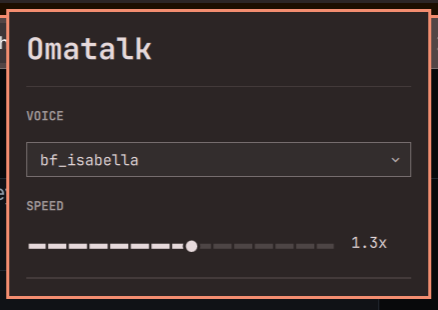

# Omatalk

Local text-to-speech for [Omarchy](https://omarchy.org). Select text, press F8,
and hear it read back. Speech runs on your CPU with
[Kokoro-82M](https://huggingface.co/hexgrad/Kokoro-82M), with no network calls
at runtime. Hear every voice on the [project site](https://omatalk.zerobearing.com).

```sh
curl -fsSL https://omatalk.zerobearing.com/install.sh | bash
```

The command installs the Daemon, which does the speaking, and the bar plugin,
which is the megaphone and voice panel. It adds missing packages with
`omarchy pkg add`, downloads the models (about 355MB), and asks before it binds
F8. If F8 is taken, it prints a command to paste instead. A plugin you already
added from the Omarchy Marketplace stays as it is.

If the plugin add failed, run this. The plugin does nothing without the Daemon.

```sh
omarchy plugin add https://github.com/zerobearing2/omarchy-omatalk-plugin.git --enable
```

## Use it

Highlight text anywhere and press F8. Omatalk reads the selection, or the
clipboard if nothing is selected. Speech starts about a third of a second after
the press and streams as it is synthesized.

Press F8 while it is speaking to interrupt. If the selection is the same or
empty, speech stops. If it changed, the new text replaces the old.

The megaphone in the bar uses the normal color when ready, the accent color
while speaking, and red when the Daemon reported an error or the bar lost it for
more than 3 seconds. Click it to set the voice and speed. Picking a voice speaks
a short sample.



From a terminal:

```sh
omatalk speak                       # capture and speak (what the hotkey runs)
omatalk speak "text here"           # speak given text
omatalk speak --voice af_bella "hi" # speak once in a voice, default unchanged
omatalk stop                        # cut off the current speech
omatalk status                      # idle | speaking | error
omatalk version                     # print the installed release
omatalk config get [--json]         # print the effective config
omatalk config set voice af_bella   # set the voice
omatalk config set speed 1.25       # set the speed (0.5-2.0)
omatalk config voices [--json]      # list voice names
```

## Render a voiceover

`omatalk render --out PATH [--voice NAME] [--speed N] [TEXT...]` writes a
whole script to a WAV file. It takes the text from its arguments or, with
none, from stdin:

```sh
omatalk render --out talk.wav < script.txt
omatalk render --out talk.wav --voice af_bella --speed 0.95 "Welcome to the demo."
```

Render favors quality over latency. It never talks to the Daemon, so it works
with the Daemon stopped, but it loads its own copy of the model. A blank line
in the script is a beat: sentences get a short pause, and a paragraph gets a
longer one. A single newline does not break a paragraph. Speed defaults to
`1.0`, not your configured speed, because that is a listening preference. The
voice defaults to your configured one.

Render holds all audio in memory until it writes the file. Expect a peak of
about 920 MiB plus 3 MiB per minute of audio (1.1 GiB for 60 minutes), on top
of the Daemon, and about 10 seconds of render time per minute of audio.

Render writes WAV only (16-bit mono, 24 kHz) and refuses any other
extension. Convert with ffmpeg:

```sh
ffmpeg -i talk.wav talk.mp3
```

The file appears only when the whole render succeeds. A failed render leaves
an existing file untouched. `--out` replaces its target (a symlink is replaced,
not followed), and the new file gets default permissions. On success it prints
the path and the audio's length.

## Config

The panel and `omatalk config set` save to `~/.config/omatalk/config.toml`.
They set voice and speed. Edit the file by hand for the rest. The file does not
exist until you set something, and every key is optional. Each press reads the
file again, so changes apply to the next press with no restart.

| Key | Default | What it does |
|---|---|---|
| `voice` | `"af_heart"` | Voice for every Utterance. `omatalk config voices` lists the names. |
| `speed` | `1.0` | Speech rate, 0.5 to 2.0. |
| `wake_lead_ms` | `650` | Silence before speech on a suspended Bluetooth or HDMI sink, 0 to 2000. 0 turns it off. See [Bluetooth and HDMI audio](#bluetooth-and-hdmi-audio). |
| `capture_primary` | `["wl-paste", "--primary"]` | Command that prints the selection. |
| `capture_clipboard` | `["wl-paste"]` | Command that prints the clipboard, used when nothing is selected. |
| `player` | `["pw-cat", "-p", "--raw", "--format", "s16"]` | Command that plays raw s16le mono from stdin. Omatalk appends `--rate 24000 --channels 1 -`. |
| `notify` | `["notify-send", "Omatalk"]` | Command for desktop notifications. The message is appended as the last argument. |
| `sink_probe` | `["pactl"]` | pactl-compatible command for the sink check. Omatalk appends `get-default-sink`, then `list sinks short`. |
| `lang` | `"en-us"` | Accepted for compatibility. Every value reads as `en-us`, the only language. |

Commands are lists of strings, not shell lines. A bad value makes the press
fail with a notification naming the key, for example
`config.toml: speed must be between 0.5 and 2.0`. Unknown keys are ignored.

## Bluetooth and HDMI audio

Bluetooth speakers and HDMI or DisplayPort monitors mute for about half a
second after they wake, and their sink suspends after 5 seconds of silence.
Analog speakers and headphones are not affected. Pick how Omatalk handles the
gap:

- By default, a press to a sleeping device waits about 0.65 s and the first word
  is intact. If it still clips, raise `wake_lead_ms` in steps of 100.
- With `wake_lead_ms = 0`, speech starts at once, but after 5 s of silence the
  first word may be lost.
- With sink suspend off, speech starts at once and nothing clips, but the device
  never sleeps. Create
  `~/.config/wireplumber/wireplumber.conf.d/51-disable-suspend.conf`, then run
  `systemctl --user restart wireplumber`:

```
monitor.alsa.rules = [
  {
    matches = [ { node.name = "~alsa_output.*" } ]
    actions = { update-props = { session.suspend-timeout-seconds = 0 } }
  }
]
monitor.bluez.rules = [
  {
    matches = [ { node.name = "~bluez_output.*" } ]
    actions = { update-props = { session.suspend-timeout-seconds = 0, node.suspend-on-idle = false } }
  }
]
```

## Upgrade and uninstall

`omatalk upgrade` installs the latest release. Upgrades never touch
`config.toml`. `omarchy plugin update zerobearing.omatalk` updates the bar
plugin, which releases on its own.

`omatalk uninstall` removes the Daemon, its systemd unit, and the bar plugin.
It asks before it deletes the models, your config, and the F8 binding. If the
`omatalk` command is already gone, run:

```sh
curl -fsSL https://omatalk.zerobearing.com/uninstall.sh | bash
```

`omarchy plugin remove zerobearing.omatalk` removes only the megaphone. The
Daemon, models, and config stay, and F8 still speaks.

## Troubleshooting

**Red megaphone, or F8 says the Daemon is not running.** Check the Daemon, then
start it:

```sh
omatalk status
journalctl --user -u omatalk.service -b --no-pager -n 80
systemctl --user start omatalk.service
```

The bar reconnects by itself within a few seconds. If `omatalk status` works
and the megaphone stays red, run `omarchy restart shell`.

**The Daemon exits at startup with a library error.** Run
`omarchy pkg present onnxruntime-cpu espeak-ng`. The Daemon and `omatalk render`
load `libonnxruntime.so.1` and `libespeak-ng.so.1`. To use another onnxruntime
build, set `ORT_DYLIB_PATH` to its library in the unit's environment.

## More

[Domain language](GLOSSARY.md), [design decisions](docs/adr/),
[bar plugin](https://github.com/zerobearing2/omarchy-omatalk-plugin), and the
[contributor guide](AGENTS.md).

The voice is [Kokoro-82M](https://huggingface.co/hexgrad/Kokoro-82M) by
[hexgrad](https://github.com/hexgrad/kokoro), through the ONNX export from
[kokoro-onnx](https://github.com/thewh1teagle/kokoro-onnx). Phonemes come from a
Rust port of [misaki](https://github.com/hexgrad/misaki) and the spaCy
`en_core_web_sm` tokenizer and tagger. Built for
[Omarchy](https://github.com/omacom/omarchy) by DHH. MIT license.
