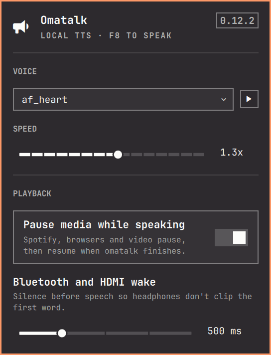

# Omatalk bar plugin

Local text-to-speech for Omarchy: select text, press F8, the machine reads it
back. A megaphone in the bar follows idle, speaking, and unavailable.



This is the bar widget and config panel. It lives in
[zerobearing2/omatalk](https://github.com/zerobearing2/omatalk) under
`plugin/zerobearing.omatalk/` and ships inside the `omatalk-bin` package, so it
always matches the Daemon it came with. The plugin does not work without that
Daemon, and it never starts, stops, or installs it.

## Install

```sh
omarchy pkg add omatalk-bin && omatalk setup
```

The package puts the plugin at
`/usr/share/omatalk/omarchy-plugin/zerobearing.omatalk/`. `omatalk setup`
links it into `~/.config/omarchy/plugins/` and enables it. Until the Daemon is
installed, the panel links to https://omatalk.zerobearing.com/#install.

If the megaphone is missing, reload the bar:

```sh
omarchy restart shell
```

## Update and remove

`omarchy update` updates the plugin with the package. `omatalk uninstall`
removes the link, the Daemon's files, and the package.

## Development

The plugin calls `/usr/bin/omatalk` only. `make test-plugin` in the repo root
runs `tests/run.sh`, and CI runs it too. The version in `manifest.json` stays
`0.0.0-dev`: `scripts/build.sh` stamps the release version into the packaged
copy.
